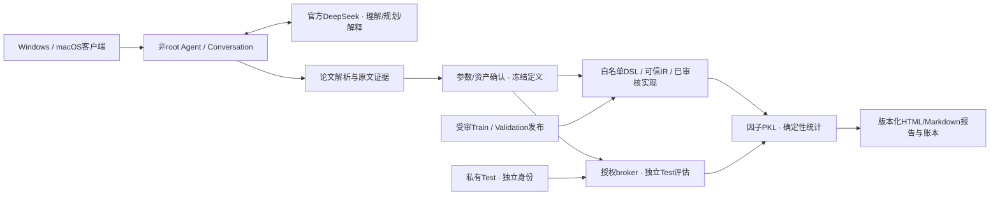

# Jijigua_Quant_Agent

**用自然语言组织量化因子研究，把论文主张、可信计算、统计证据和研究报告连接起来。**

[English](README_EN.md) · [文档导航](docs/README.md) · [研发历史](docs/history/TIMELINE.md) · [事故档案](docs/history/INCIDENTS.md) · [可复现演示](docs/guides/REPRODUCIBILITY.md)

> 当前为**AGPL-3.0-only开源归档版**，已获所有者公开批准。源码来自2026-10-15采集的一致研发快照；产品内部称v1.0 Beta，Python发行元数据仍为0.8.2。这不是新的生产发布。候选包含部分预发布加固，不能将其全部称为已部署能力。[来源与版本](docs/release/SNAPSHOT_STATUS.md)

## 为什么做这个项目

量化研究的难点不仅是计算一个公式，还包括确认论文到底定义了什么、窗口和单位是否正确、数据是否足够、标签何时成熟，以及结果是否能独立核对。本项目让LLM负责理解、调查与解释，让受控程序负责数据访问、数学计算、授权、产物和账本。普通聊天不应触发无关研究；有歧义或不支持的定义应澄清或阻断。

系统是**探索性研究助手**。当前行情合同不能证明历史上市状态、复权、公司行动及可成交性全部可信，因此理论分组收益不是实盘收益；正式账户回测保持BLOCKED，任何统计表现不构成投资建议或收益承诺。

## 主要能力及真实边界

| 模块 | 公开源码包含什么 | 边界 |
|---|---|---|
| 对话 | Provider抽象、官方DeepSeek工具协议、会话与任务分离、预算 | 离线Mock是固定工程例子，不是自然语言理解 |
| 论文 | 本地PDF/HTML/DOCX/文本解析、页码与bbox、引文检索、AI主张核验 | PDF不可靠时不能猜公式；文本模型不能看保存的页面截图 |
| 定义 | 19算子DSL、LaTeX/IR、参数及资产确认、定义指纹 | 论文自由参数必须由用户选择，替代研究需确认 |
| 执行 | 固定因子、可信IR参考与向量化执行器；候选代码审核/注册 | AST不是沙箱；获批源码在非root进程执行，不能用于不可信多租户服务 |
| 数据 | 资源白名单、独立Train/Validation读取、静态PKL解析组件 | 不附带内部行情；不得给模型任意路径或完整历史PKL |
| 评价 | IC/RankIC、HAC、年/月、覆盖、分组、自相关与衰减 | 月度HAC因样本不足显示N/A；IR未年化 |
| 独立Test | 独立身份、root broker、冻结定义、签名回执、次数与曝光记录 | 不是普通数据Resource；公开下载后不会自动拥有2026数据或授权 |
| 交付 | 默认验证PKL、CSV、离线LaTeX、HTML/Markdown、交互图与静态图 | 缺少成熟标签必须保留N/A；PKL失败不能宣称完整交付 |
| 客户端 | Windows/macOS共用标准库客户端、SSH/SCP、批量上传与去重 | macOS真机状态见验收表；需要用户自己的已配置服务器 |

各项最新本地测试与历史内部验收分别列于[验收报告](docs/release/TEST_RESULTS.md)。[Known Issues](docs/KNOWN_ISSUES.md)记录尚未解决的问题。

## 架构总览



详细内容：[系统架构](docs/architecture/SYSTEM.md)、[安全边界](docs/architecture/SECURITY.md)、[数学合同](docs/architecture/MATHEMATICS.md)、[论文可靠性](docs/architecture/PAPER_RELIABILITY.md)、[逐模块目录](docs/architecture/MODULE_CATALOG.md)。

## 环境

- Agent：CPython 3.11或3.12；数值依赖固定于`requirements-research.lock`，不建议在共享全局环境安装。
- 离线核心：jsonschema；数值和报告：NumPy、Pandas、Matplotlib，Plotly.js随源码附带MIT声明，无外部CDN。
- 论文解析可选：PyMuPDF、BeautifulSoup、python-docx；**PyMuPDF为AGPL/商业双许可**，项目自有代码已选AGPL-3.0-only；第三方条款继续适用，见[许可证审查](docs/release/LICENSE_REVIEW.md)。
- 本地SSH客户端：Python ≥3.9、系统OpenSSH，不需要把研究计算环境装到客户端。
- Linux特权启动器需要专门的用户、数据发布、权限和审批配置；不能把`deploy/`脚本当作普通安装脚本直接在现有服务器运行。

## Windows快速开始：完全离线

在仓库根目录的PowerShell执行：

```powershell
py -3.12 -m venv .venv
.\.venv\Scripts\python.exe -m pip install -r requirements.lock -r requirements-research.lock
.\.venv\Scripts\python.exe -m pip install --no-deps --no-build-isolation -e .
.\.venv\Scripts\python.exe -m research_agent --state-dir demo_output\mock demo
.\.venv\Scripts\python.exe examples\offline_research.py --output demo_output\factor_run_01
```

第一条演示是Mock流程，第二条使用固定随机种子的合成行情，生成真实程序计算的因子PKL、指标、图表和报告。结果不是市场研究证据。输出目录已存在时拒绝覆盖。完整步骤与预期文件见[复现指南](docs/guides/REPRODUCIBILITY.md)。

## macOS / Linux快速开始：离线核心

```bash
python3.12 -m venv .venv
.venv/bin/python -m pip install -r requirements.lock -r requirements-research.lock
.venv/bin/python -m pip install --no-deps --no-build-isolation -e .
.venv/bin/python -m research_agent --state-dir demo_output/mock demo
.venv/bin/python examples/offline_research.py --output demo_output/factor_run_01
```

Python 3.11也在声明支持范围内。固定依赖不保证Python 3.13+可安装。macOS基础CI配置不等于真机已验收；本次实际运行环境见测试报告。Linux中文图需要覆盖CJK的本机字体，不附带商业字体。

## 连接自己的服务器

本地客户端与服务器Agent是不同入口。只有管理员已经完成服务端配置时，以下命令才有意义：

```powershell
python tools/quant_paper/quant_paper.py setup --host gpu.example.org --port 22 --user YOUR_LOGIN --identity C:/Keys/your_key
python tools/quant_paper/quant_paper.py upload "C:/Papers/example.pdf"
python tools/quant_paper/quant_paper.py list
python tools/quant_paper/quant_agent.py chat
```

macOS可运行`sh tools/quant_paper/install_macos.sh`安装当前用户包装器。首次SSH应人工核验主机指纹，不能关闭StrictHostKeyChecking。客户端配置不保存口令；API Key在服务端隐藏输入，不应写入聊天、命令参数、代码或公开CI。

详见[Windows指南](docs/guides/WINDOWS.md)、[macOS指南](docs/guides/MACOS.md)、[Linux部署边界](docs/guides/LINUX_DEPLOYMENT.md)。

## 自然语言研究示例

在自己的受审服务器`quant-agent chat`中：

```text
研究我刚上传的论文，先核对因子定义和数据是否匹配。
使用已经授权的Train数据研究五日反转，在Validation评价并生成报告。
把观察窗口改为10天，作为独立版本与之前比较。
给我看最新报告，以及Test状态和标签成熟限制。
```

这些是使用示例，**不是公开环境自动具备真实行情的承诺**。论文需要用户合法提供；若研究对象为期货、指数或期权，不能偷偷换成A股个股。参数未说明时请用户选择；“提交Test”也不能替代独立操作者的授权。

## 数据、评价与成果

内部历史发布曾覆盖Train 2020–2023和Validation 2024–2025，固定5427代码轴；轴长度不等于每日可交易股票数。volume为手，amount为千元，六字段为原始未复权口径。公开仓库**不附带这些数据及私有manifest**。

每个新因子研究默认导出日期×股票浮点面板PKL，并验证NaN、索引、代码和SHA；不包含未来收益标签。产物按时区Asia/Shanghai的日期、时间与安全因子名归档。研究ID、定义及数据版本写入manifest；报告revision追加而不覆盖历史。

IC是日度横截面Pearson相关，RankIC是平均秩的相关；ICIR=日度均值/样本标准差，未年化。G0是最高因子组，G0−G4是理论未来毛收益差，不是账户净值。HAC考虑重叠标签，但不能修复数据与选参偏差。年/月统计、热力图、表格必须共用保存的逐日证据。

统一报告从创建起保留Train/Validation/Test。未授权Test显示SEALED/NOT_RUN；合法评价后同研究ID生成新版。已曝光历史Test只能称回顾性或冻结后受控评价，不能重新称盲测。[报告与数据合同](docs/architecture/DATA_REPORTS.md)

## 验证与开发

```bash
python -m pytest -q -p no:cacheprovider
python tools/release_audit.py
python tools/numcheck_metrics.py PATH_TO_YOUR_SYNTHETIC_REPORT_RUN
```

全测试的Linux启动器部分在Windows跳过；已知遗留断言不兼容不能当作通过。详见[实际测试记录](docs/release/TEST_RESULTS.md)。真实DeepSeek、服务器权限与2026评价测试不进默认公开CI。[开发指南](docs/guides/DEVELOPMENT.md)说明如何扩展Tool、IR与指标。[贡献说明](CONTRIBUTING.md)和[安全报告渠道](SECURITY.md)适用于后续维护。

## 仓库导航

```text
src/research_agent/  对话、授权、工具、计算、报告、账本
src/paper_agent/     AI理解、程序核对、参数与资产、审核注册
src/paper_research/  解析、证据、研究规格、LaTeX/IR参考实现
src/rolling_test/    独立评价broker、发布、评估与协议
src/qrtk*/          已集成计算工具包及其本地合同
tests/              离线合成、拒绝、数值和工作流回归
tools/quant_paper/   Windows/macOS SSH客户端
tools/              复算、指纹、报告验证与发布门禁
deploy/             需管理员审阅的环境模板与运维脚本
examples/           无私有数据或Key的离线演示
docs/               用户/开发/架构/历史/许可证/验收
provenance/         来源、转换、文件指纹与版本差异
```

## 研发历史、已知问题与路线图

完整历史见[时间线](docs/history/TIMELINE.md)和[事故目录](docs/history/INCIDENTS.md)。这里保留错误放行、服务故障、错误公式、统计限制及工程事故，不把所有失败都归因于模型。187份脱敏历史证据保留当时状态，不等于今天仍有效。

近期重点是论文重复运行稳定性、候选代码隔离、公开可部署的数据适配、跨平台实机验证及受审正式回测前置条件。不会自动将内部最新源码同步到公开仓库。[维护与发布流程](docs/release/SAFE_SYNC.md)

## 许可证、致谢与引用

项目自有代码已由所有者授权按[AGPL-3.0-only](LICENSE)公开。第三方文件保留各自声明，不能用项目LICENSE覆盖其条款。工具包、原回测绘图适配及外部消费函数的权利边界见[清单](docs/release/LICENSE_REVIEW.md)。

感谢NumPy、Pandas、Matplotlib、jsonschema、Plotly.js及文档解析生态。Codex与Claude参与辅助开发，但AI辅助不等于上游材料自动可再分发。科研引用可先引用仓库名称与最终实际发布的提交SHA；正式版本DOI和软件引文尚未注册。

## 实际离线示例与最终审阅

[合成研究HTML与截图](docs/examples/README.md) · [实际测试结果](docs/release/TEST_RESULTS.md) · [归档转换记录](docs/release/ARCHIVAL_CHANGES.md) · [最终公开审批包](docs/release/PUBLIC_RELEASE_APPROVAL.md)

## 当前公开许可

Copyright © 2026 jijigua1。所有者于2026-10-15批准本归档范围及原创模块分发权，项目自有代码按[AGPL-3.0-only](LICENSE)公开。第三方代码、字体与资源仍按各自条款，详见[通知](THIRD_PARTY_NOTICES.md)和[权利确认](provenance/OWNER_APPROVAL.json)。历史证据中的“等待许可”是当时状态，不是当前授权。
