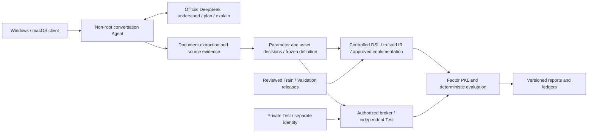

# Jijigua_Quant_Agent

**A natural-language quantitative research assistant connecting paper evidence, controlled computation, statistical evaluation and versioned reports.**

[中文](README.md) · [Documentation](docs/README.md) · [Development history](docs/history/TIMELINE.md) · [Incidents](docs/history/INCIDENTS.md) · [Offline reproduction](docs/guides/REPRODUCIBILITY.md)

> This is an **owner-approved AGPL-3.0-only archival release**, not a new production release. The consistent source snapshot was captured on 2026-10-15. The internal product is called v1.0 Beta while Python distribution metadata remains 0.8.2. Some included hardening is staging-only. The owner approved this public scope and the original-code licensing rights; third-party terms remain applicable.

## Purpose

Computing a factor is only one part of research. A reproducible study must establish what a paper actually defines, bind its free parameters, check units and timing, identify data limitations and preserve independently checkable evidence. This project delegates understanding, investigation and explanation to the language model, while deterministic programs control authorization, data access, mathematics, artifacts and ledgers.

It is an **exploratory research system**, not a production trading platform. Historical listing information, corporate actions, adjusted prices and execution states are not fully certified. Theoretical forward group returns are not executable account returns. Formal account backtesting remains BLOCKED. No investment performance is promised.

## Capabilities and limits

| Area | Included implementation | Important limit |
|---|---|---|
| Conversation | Provider abstraction, official DeepSeek protocol, tools, sessions and budgets | Offline Mock follows a fixed engineering example; it does not understand arbitrary language |
| Documents | PDF/HTML/DOCX/text ingestion, page coordinates, retrieval and citation checks | Unreadable formulas must not be guessed; the text model cannot inspect saved page screenshots |
| Definitions | 19-operator DSL, LaTeX/IR, parameter and asset decisions, frozen fingerprints | Unstated parameters and asset substitutions require user decisions |
| Execution | Fixed factors, trusted reference/vectorized IR, reviewed implementation registry | AST review is not a sandbox; approved Python runs with the non-root Agent's permissions |
| Data | Resource allowlists and partition readers | No internal market data is distributed; models cannot choose arbitrary paths |
| Evaluation | IC/RankIC, HAC, annual/monthly metrics, groups, coverage, decay and stability | Monthly HAC is unavailable under short-sample rules; IR is not annualized |
| Independent Test | Separate evaluator, privileged broker, signatures, frozen definitions and exposure tracking | Not a normal model-readable resource and not automatically available to GitHub users |
| Artifacts | Verified PKL, CSV, offline formulas, HTML/Markdown and chart exports | Missing mature labels remain N/A; failed PKL delivery is not complete research |
| Client | Shared Windows/macOS Python client, SSH/SCP, batch upload and content deduplication | Requires your own configured server; cross-platform tests are not equivalent to real macOS acceptance |

[Snapshot status](docs/release/SNAPSHOT_STATUS.md) distinguishes production evidence, staging evidence and this candidate. [Known issues](docs/KNOWN_ISSUES.md) and [test results](docs/release/TEST_RESULTS.md) retain failures instead of presenting them as successes.

## Architecture



See [system architecture](docs/architecture/SYSTEM.md), [security](docs/architecture/SECURITY.md), [mathematical contracts](docs/architecture/MATHEMATICS.md), [paper reliability](docs/architecture/PAPER_RELIABILITY.md), and the [module catalogue](docs/architecture/MODULE_CATALOG.md). Detailed historical evidence is primarily in Chinese; this README includes the essential setup, behavior and safety boundaries in English.

## Requirements

- Agent: CPython 3.11 or 3.12. Use a dedicated virtual environment. Dependency pins do not claim support for Python 3.13+.
- Core: jsonschema. Numerical/reporting stack: NumPy, Pandas and Matplotlib. Plotly.js is bundled with its MIT notice; reports do not require a CDN.
- Optional document parsing: PyMuPDF, BeautifulSoup and python-docx. **PyMuPDF uses AGPL/commercial licensing**; review [licensing](docs/release/LICENSE_REVIEW.md) before redistribution or deployment.
- Local SSH client: Python 3.9+ and system OpenSSH. Research runs on the server, not on the upload client.
- Linux privileged deployment scripts require an administrator-reviewed account, filesystem and data contract. Do not run them on an existing production machine as a generic installer.

## Windows: fully offline quick start

Run in PowerShell from the repository root:

```powershell
py -3.12 -m venv .venv
.\.venv\Scripts\python.exe -m pip install -r requirements.lock -r requirements-research.lock
.\.venv\Scripts\python.exe -m pip install --no-deps --no-build-isolation -e .
.\.venv\Scripts\python.exe -m research_agent --state-dir demo_output\mock demo
.\.venv\Scripts\python.exe examples\offline_research.py --output demo_output\factor_run_01
```

The first command runs a fixed Mock workflow. The second computes a factor from seeded synthetic market data and writes PKL, metrics, figures and HTML/Markdown reports. These are engineering examples, not market evidence. Existing output directories are never overwritten. See [reproduction](docs/guides/REPRODUCIBILITY.md) for expected files and verification commands.

## macOS / Linux: offline core

```bash
python3.12 -m venv .venv
.venv/bin/python -m pip install -r requirements.lock -r requirements-research.lock
.venv/bin/python -m pip install --no-deps --no-build-isolation -e .
.venv/bin/python -m research_agent --state-dir demo_output/mock demo
.venv/bin/python examples/offline_research.py --output demo_output/factor_run_01
```

Python 3.11 is also in the declared support range. Linux Chinese charts require a locally installed CJK font. Commercial fonts are not redistributed. A configured macOS CI job is not evidence that the job or a real Mac has passed; consult the test report for actual execution.

## Connect to your own server

The local client and server Agent are separate entry points. The following commands require a server your administrator has already configured:

```bash
python tools/quant_paper/quant_paper.py setup --host gpu.example.org --port 22 --user YOUR_LOGIN --identity /path/to/private_key
python tools/quant_paper/quant_paper.py upload /path/to/your_authorized_paper.pdf
python tools/quant_paper/quant_paper.py list
python tools/quant_paper/quant_agent.py chat
```

On macOS, `sh tools/quant_paper/install_macos.sh` installs per-user wrappers. Verify the server host fingerprint manually on the first SSH connection. Never disable StrictHostKeyChecking. The client stores connection parameters, not passwords. Use the server's hidden API-key prompt; do not put secrets in chat, command arguments, source files or public CI.

Detailed guides: [Windows](docs/guides/WINDOWS.md), [macOS](docs/guides/MACOS.md), [Linux deployment](docs/guides/LINUX_DEPLOYMENT.md).

## Research examples

In an operator-approved server session started with `quant-agent chat`, you can ask the Agent to:

1. Inspect the paper you just uploaded, locate its evidence, and check whether its factor definition matches the available assets and data.
2. Study a five-day reversal factor on approved Train data and evaluate it on Validation.
3. Change the observation window to ten days as a separate, explicitly confirmed experiment.
4. Locate the latest full report and explain Test status and label maturity.

Internal live acceptance has primarily used Chinese prompts. These examples do not imply that a public checkout contains real market data. Papers must be supplied legally by users. Futures, options or index research cannot silently become an A-share stock study. A request to submit Test does not replace independent operator approval.

## Data and research contracts

Historical internal releases covered Train 2020–2023 and Validation 2024–2025 with a fixed 5,427-code axis. An axis length is not the daily tradable universe. The reviewed six raw fields are open, high, low, close, volume and amount; volume is in lots and amount in thousands of CNY. Raw unadjusted returns are not corporate-action-adjusted total returns. **Those private datasets and deployment manifests are not included.**

New factor computation automatically produces a floating-point date-by-security PKL, preserving missing values and checking axes, codes, values and SHA-256. Forward labels do not enter the exported factor file. Human-readable run directories use Asia/Shanghai timestamps. Internal IDs, definition and data versions remain in manifests; report revisions are append-only.

IC is daily cross-sectional Pearson correlation. RankIC correlates average-tie ranks. ICIR is the daily mean divided by sample standard deviation, without annualization. G0 is the highest factor-score group; G0−G4 is a theoretical forward gross-return spread, not an account NAV. HAC handles dependence assumptions but cannot remove data or repeated-selection bias. Tables, heatmaps and figures share the same saved daily evidence.

Every report has Train/Validation/Test from its first revision. Unapproved Test remains SEALED/NOT_RUN. An authorized evaluation creates a new revision under the same study ID. Exposed historical Test is retrospective or controlled post-freeze evaluation, not an untouched blind sample. See [data and report contracts](docs/architecture/DATA_REPORTS.md).

## Testing, extension and operations

```bash
python -m pytest -q -p no:cacheprovider
python tools/release_audit.py
python tools/numcheck_metrics.py PATH_TO_YOUR_SYNTHETIC_REPORT_RUN
```

Linux-only launcher checks are skipped on Windows. Known failures are recorded; they are not converted into passes. Default public CI must not invoke real DeepSeek, privileged deployment or private Test evaluation. See [actual test results](docs/release/TEST_RESULTS.md), [developer guide](docs/guides/DEVELOPMENT.md), [contribution rules](CONTRIBUTING.md) and [security policy](SECURITY.md).

## Repository layout

| Directory | Responsibility |
|---|---|
| `src/research_agent` | Conversation, authorization, tools, computation, reporting and ledger |
| `src/paper_agent` | Model reading, deterministic reconciliation, planning and reviewed registry |
| `src/paper_research` | Document extraction, research specifications, LaTeX and reference IR |
| `src/rolling_test` | Independent evaluator, broker, publisher and protocol |
| `src/qrtk*` | Integrated numerical toolkit and local contracts |
| `tests` | Offline synthetic, numerical, rejection and workflow checks |
| `tools/quant_paper` | Shared Windows/macOS SSH upload and research client |
| `tools` | Independent recomputation, fingerprints and release gates |
| `deploy` | Administrator-reviewed deployment templates, not automatic public setup |
| `examples` | No-key, no-private-data examples |
| `docs`, `provenance` | Guides, architecture, history, incidents, licences and source fingerprints |

## History, known issues and roadmap

The [timeline](docs/history/TIMELINE.md) and [incident archive](docs/history/INCIDENTS.md) document formula errors, incorrect admission, provider failures, statistics, caching, disk incidents and their actual evidence. Historical reports retain their contemporary status, which may be superseded later. The archive does not fabricate missing Git commits or treat every issue as a model failure.

Priorities include repeated-paper consistency, isolation for approved implementations, deployable public data adapters, real cross-platform acceptance and prerequisites for a qualified account backtest. Internal development does not automatically flow into the public repository; see [safe synchronization](docs/release/SAFE_SYNC.md).

## Licence, acknowledgements and citation

The owner approved this archival scope and the rights to the original modules on 2026-10-15. Copyright © 2026 jijigua1. Original project code is licensed under [AGPL-3.0-only](LICENSE). Third-party components retain their own notices and cannot be relicensed by a project LICENSE. Review toolkit provenance, plotting adaptations and external consumer code in the [licence review](docs/release/LICENSE_REVIEW.md).

Thanks to the NumPy, Pandas, Matplotlib, jsonschema, Plotly.js and document-processing communities. Codex and Claude assisted development, but AI assistance does not grant redistribution rights to upstream content. Cite the final public repository and the exact released commit; no software DOI has been registered.

## Inspected offline example and publication review

[Synthetic report and screenshots](docs/examples/README.md) · [Actual test record](docs/release/TEST_RESULTS.md) · [Archival changes](docs/release/ARCHIVAL_CHANGES.md) · [Publication approval package](docs/release/PUBLIC_RELEASE_APPROVAL.md)

Historical documents may retain their original pending-licence status. The current decision is recorded in [owner approval](provenance/OWNER_APPROVAL.json); third-party notices remain applicable.

## First public CI status

[Hosted CI](https://github.com/jijigua1/Jijigua_Quant_Agent/actions/runs/38706709199) is real. Publication-policy checks passed. macOS reported 538 passed, 79 skipped and 2 failed; the owner accepts those limitations for this archival publication. Windows/Linux were still running when this record was written; consult Actions for their final result. This is not a claim of universal cross-platform compatibility. See the [delivery report](docs/release/FINAL_REPORT.md).
