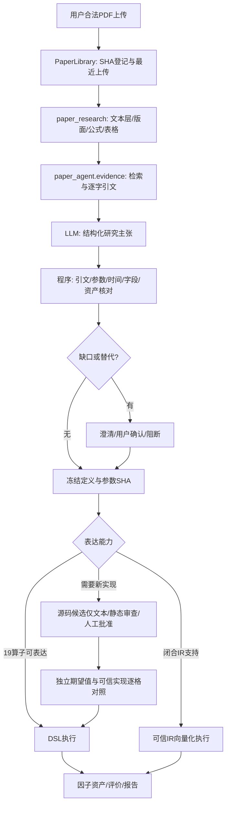

# 系统架构与调用链

本章依据归档源码而不是模块名猜测。入口为`research_agent.cli:main`；本地SSH客户端是`tools/quant_paper/quant_paper.py`，Linux特权入口是`deploy/launcher_v1.py`，两者不能混同。产品版本、包元数据、论文理解版本和IR语义版本也必须分别记录。

## 1. 对话与工具

`app.py`构建Provider、Policy、ResourceCatalog、SkillRegistry、TaskStore及QuantBackend。`conversation.py`维护会话、研究引用、摘要与路由；`workflow.py`执行研究工具循环；`llm.py`定义消息、工具调用、用量和错误合同；`providers/deepseek.py`实现固定官方HTTPS端点及原生function calling。Mock与真实Provider共用合同，但Mock没有自然语言能力。

模型生成的参数经过Tool Schema、`security.authorize`、Skill能力交集与任务预算。Tool许可先落账本，再执行固定handler；失败按参数、授权、Provider、计算、导出等分类。`store.py`记录任务、授权、实验与事件；会话历史不意味着新的权限授予。

## 2. 论文链

LLM主张由`understanding.py`与`reconcile.py`核对，规划由`planner.py`完成。`paper_research.factor_ir`提供可审核参考语义，`paper_agent.trusted_ir`提供向量化实现。`algorithm.py`生成的是候选文本；`registry.py`只有精确SHA的人类批准后才可能在非root进程执行。生产独立Test只接受其可信算法合同；批准一段Python不等于独立评估器可执行它。

## 3. 数值与报告

`quant.py`连接Tool与资源，`published_release.py`读取已发布矩阵，`factor_expression.py`检查闭合DSL，`historical_evaluation.py`处理Train/Validation及标签成熟。`qrtk.factor_eval`承担横截面计算，`factor_evaluation.py`和`metric_system.py`从日度证据生成描述统计和HAC。`research_report.py`、`interactive_report.py`、`report_versions.py`处理图表、版本与统一三阶段报告。

PKL由`factor_export.py`的固定写入与读回验证生成。图表与表格共用CSV/JSON，不能由模型填写数字。报告归档在`artifacts.py`限定的工作区，新目录使用真实时间和安全因子名，ID保留于manifest和SQLite。

## 4. 独立评价边界

`rolling_test.protocol`约束消息；父进程broker持私有配置，普通Agent经受限FD客户端提交冻结定义。发布器只打开固定源，低权限身份静态解析，独立评估身份读取私有快照；回执只返回获准聚合与逐日评价证据。`rolling_client.py`核验登记及签名结果，报告追加revision。

这是内部可部署架构，不是仓库用户一键拥有的服务；身份、数据、ACL、签名密钥、预算与批准均不随仓库提供。生产与预发布是两套代码/工作区/授权路由，候选存在不证明已经切换生产。

## 5. 负载与运行约束

设计目标是单用户或少量前台研究会话，不是公开多租户SaaS。矩阵计算有数据单元、文件数、磁盘与合作式时间预算；部分特权解码另有OS限制。研究进程并非整树沙箱，SSH断线和远程孤儿进程须单独处理。不要把预算字段或AST审查宣传为全系统安全隔离。
