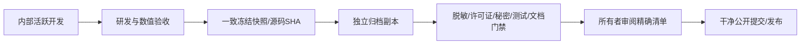

# 内部研发到公开仓库的安全同步

1. 内部最新代码不自动镜像。先明确该版本为生产、预发布或未验收快照。
2. 采集清单与全部源码双读SHA；有并发变化就停止该次快照，不凑不同时间文件。
3. 公开仓库不继承私有原Git历史。历史只以脱敏证据和真实来源指纹重建。
4. 白名单采集源码、测试、模板；数据、Key、用户日志、全文PDF、个人配置默认排除。
5. 有依赖/算子/定义/缓存语义变化时补相关测试和文档；先运行公开离线样例。
6. 验收结果写出环境与失败，不能给预发布打稳定标签。
7. 运行公开文件扫描、暂存清单检查、全部准备公开的Git提交扫描；人工审查二进制及来源。
8. 提交版本清单、变更说明、许可与排除列表，获得所有者公开披露确认。
9. 以精确路径allowlist暂存；推送后核对远端commit、文件字节与Actions，不只看push退出码。
10. 以后每次公开更新同样流程；新内部功能、生产数据或权限不能借旧批准顺带公开。

代码回滚使用公开提交的正常revert；数据与真实Test账本不会随仓库回滚。生产升级是另一份操作者审批，本开源流程不授权任何服务器替换或定时服务。
